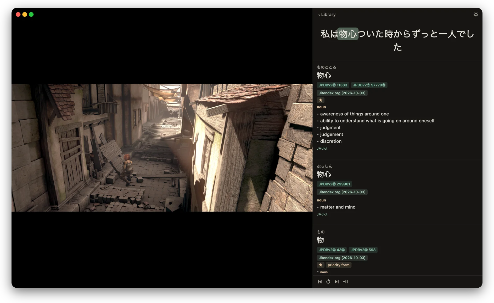
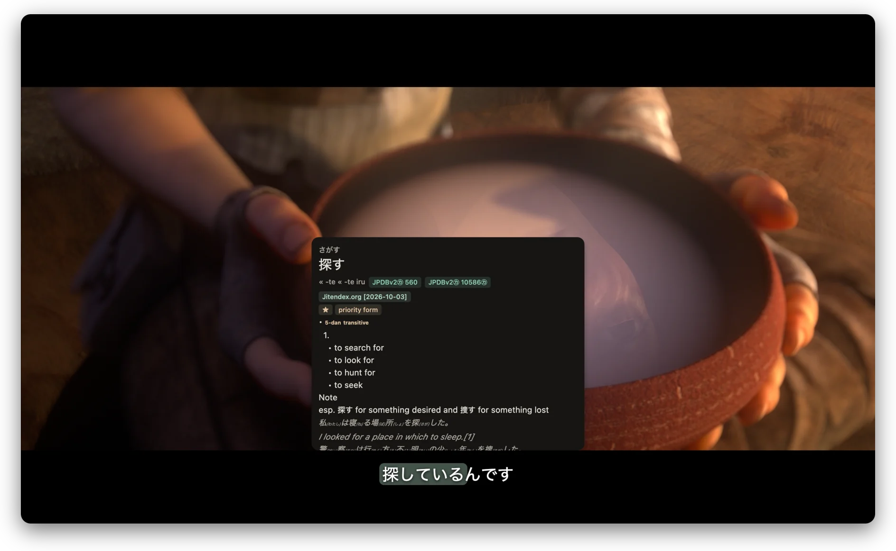
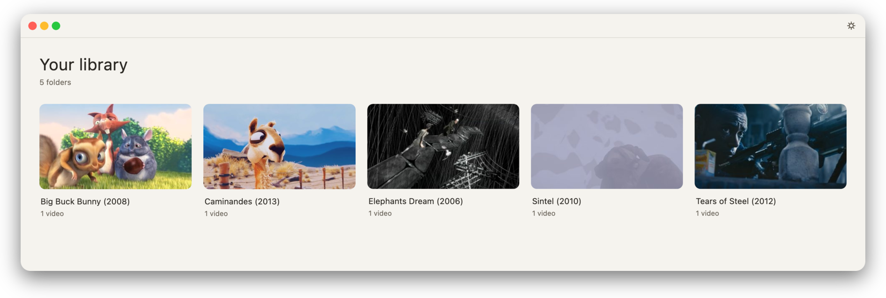
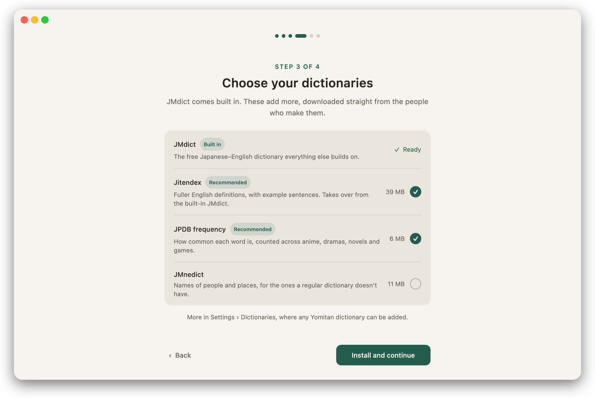
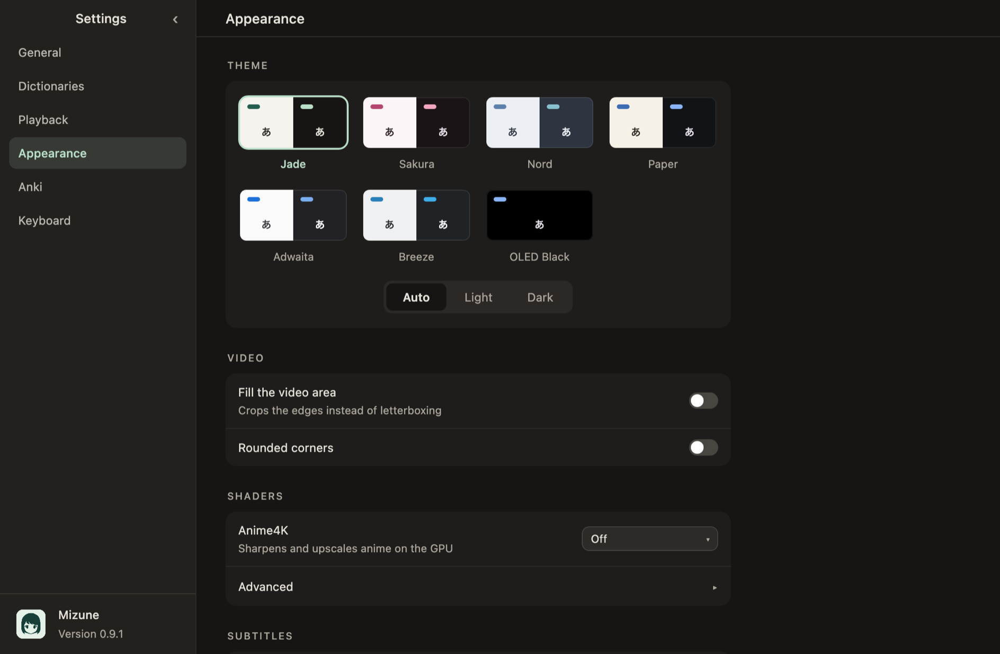
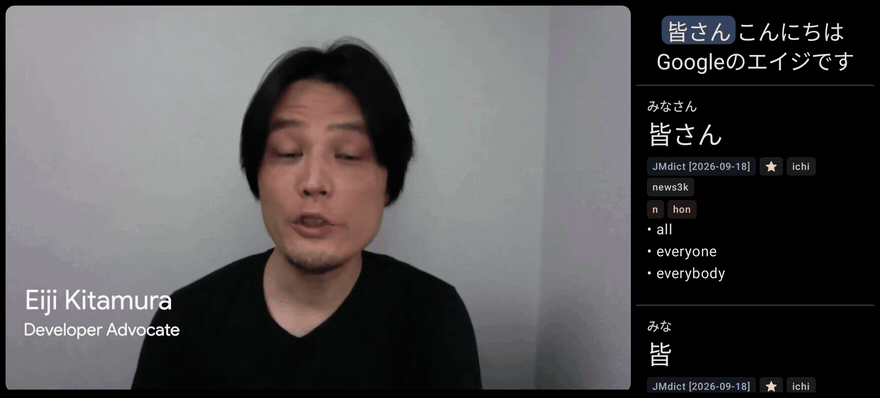
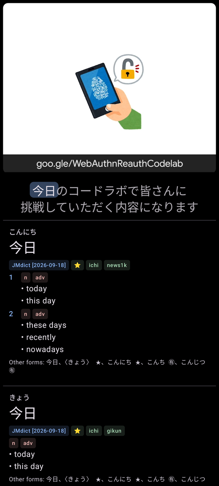

<div align="center">


# Immersion Player

**Learn Japanese from the shows you love.**

A video player with a Japanese dictionary built into the subtitles.<br>
Point at a word and it's looked up. Step back a line and hear it again. Keep the ones you want as Anki cards.

[-245D4E?style=for-the-badge&logo=apple&logoColor=white)](https://github.com/finchett/Immersion-Player/releases/latest)
[](https://github.com/finchett/Immersion-Player/releases/latest)
[-245D4E?style=for-the-badge&logo=linux&logoColor=white)](https://github.com/finchett/Immersion-Player/releases/latest)
[](https://github.com/finchett/Immersion-Player/releases/latest)

[](https://github.com/finchett/Immersion-Player/releases/latest)
[](LICENSE)


</div>

<br>



<br>

Immersion learning works: watch a lot of Japanese you enjoy, and look up what you don't know.
The trouble is the looking up. Pausing, copying a line into a dictionary, finding the word,
finding your place again. Immersion Player takes all of that out. The line being spoken sits
beside the video with a word already looked up, and every other word is a click away.

## Features

### Every word, one click away

Click a word, or drag across a phrase, and its entry appears. The lookup finds the longest word
at the point you chose and undoes the grammar on the way, so 探しているんです brings up 探す,
and 食べさせられなかった brings up 食べる, with the steps shown. Hold **i** to peek at the line in
English.

Put the panel away with **s** and the line sits over the video instead. Point at a word there and
it's looked up in place.



### Made for studying

- **Step through lines.** **h** and **l** go back and forward a line, **;** plays this one again. Turn
  on *stop at the end of every line* and the video waits for you after each one.
- **Your dictionaries.** JMdict comes built in. Add Jitendex, JPDB frequencies, pitch accent and
  anything else in Yomitan format, and their entries render in full: structured content, example
  sentences, frequency tags.
- **Anki cards in one key.** Press **a** and the word goes to Anki with the sentence, its audio, a
  moving clip or a still of the scene, the reading as furigana and its pitch accent. Works with
  any note type, and knows the popular *Japanese sentences* one field by field.
- **Subtitles from anywhere.** Sidecar files, or the tracks inside the video: SRT, ASS, WebVTT, and
  even Blu-ray picture subtitles, read with OCR as they come up.

### Your library, ready to watch

Point it at the folder your shows live in. Each folder becomes a series with a cover, episodes
sort the way you'd expect (2 before 10), release tags like `[Group] 1080p` are tidied away, and
it remembers where you stopped. When an episode ends, it offers the next.



### Set up in a minute

The first launch walks you through it: pick a look, choose your video folder, tick the
dictionaries you want (they download and install while you carry on), and connect Anki if you
use it.



### Make it yours

Themes in light and dark pairs that follow your Mac's appearance, or stay put: Jade, Sakura,
Nord, Paper, GNOME's Adwaita and KDE's Breeze, plus OLED Black for the darkest rooms. Anime4K's upscaling
shaders come built in, with a preset picked to suit your GPU.



### Always up to date

New versions download in the background and install when you quit, with a note on what's new.
Every update is signed and checked before it goes in.

## Get it

Download from the [latest release](https://github.com/finchett/Immersion-Player/releases/latest).

- **Mac (Apple Silicon, macOS 12 or newer):** open the `.dmg` and drag the app to Applications. It
  isn't notarised yet, so the first time, right-click it and choose **Open**, or run
  `xattr -dr com.apple.quarantine "/Applications/Immersion Player.app"`.
- **Android (arm64, Android 11 or newer):** install the `.apk`.
- **Windows (x64, Windows 10 or newer):** run the `.msi`. It installs for you alone, so it doesn't
  need an administrator. It isn't signed yet, so SmartScreen may stop it the first time: choose
  **More info**, then **Run anyway**.
- **Linux (x64):** the `.AppImage` runs on any distribution from about 2022 on (Ubuntu 22.04,
  Debian 12, Fedora 36 and newer) and carries everything it needs: make it executable and open it.
  On Ubuntu 24.04 or Debian 13 and newer there's also a `.deb`, installed with
  `sudo apt install ./Immersion-Player-*-linux-x64.deb`, which uses the system's libmpv.

On the Mac and Android new versions install themselves. On Windows and Linux the app tells you
when one is out and links to it; installing in place is coming.

Found a bug, or wish it did something? [Open an issue](https://github.com/finchett/Immersion-Player/issues).
It's young and changing quickly, and feedback shapes what comes next.

### Privacy

To know how many people use it and on what, the app sends one small message a day to Google
Analytics, through its Measurement Protocol (no Google SDK). It holds a random id made for your
install, your platform and system version, and the app's version. Nothing about what you watch,
look up or add to Anki, and no account. On the desktop it starts once you've finished the
welcome. Turn it off in the welcome, or any time under Settings › General › Privacy (Settings ›
Privacy on Android), and nothing more is sent. The code is
[`UsageStats`](core/src/main/kotlin/io/github/immersionplayer/stats/UsageStats.kt).

## Keys (desktop)

| Key | Does |
|---|---|
| Space | play / pause |
| h / l | previous / next line, then keep playing (back from a stop replays the line first) |
| j / k | previous / next line, stop at its end (likewise) |
| ; | replay this line, stop at its end |
| hold i, or hold the line | show the peek language |
| y / o | seek 5 s back / forward |
| n / m | shift subtitles 0.1 s earlier / later |
| u | stop at the end of every line, on or off (also the button under the panel) |
| s | put the panel away, or bring it back: the line goes over the video, where pointing at a word looks it up |
| z, or ⌘ + scroll | fill the area, or fit the whole picture |
| f, F11, or double-click | full screen |
| ⌘ (or Ctrl) + 1–6 | Anime4K mode A, B, C, A+A, B+B, C+A (turns it on at Auto if it's off) |
| ⌘ (or Ctrl) + 0 | Anime4K off |
| Esc | close a lookup over the video, leave full screen, then back to the library |
| click / drag a word | look it up |
| a | add the looked-up word to Anki (when turned on) |
| Return | at the end of a video, play the next one in its folder |

Paused, `l` and `k` carry on playing rather than skipping ahead; press again once it plays to
jump to the next line. `h` and `l` also hold off `u`, so the video runs on until you ask for a
stop again with `j`, `k` or `;`.

## Android: no buttons

On a phone every action is a gesture, and the app lists them once, on first run.



| Where | Gesture | Does |
|---|---|---|
| Video | tap | play / pause |
| Video | double-tap left or right edge | −5 s / +5 s, and keep tapping to stack |
| Video | drag sideways | scrub; move up or down mid-drag to scrub faster |
| Video | pinch | fill the area, or fit the whole picture |
| Video (paused) | tap or drag the bottom line | seek |
| Line | tap a word | look it up |
| Line | drag across the text | look up exactly what you selected |
| Line | hold | show the English translation |
| Panel | swipe sideways | previous / next line (back from a stop replays the line first) |
| Panel | tap | play / pause |
| Panel | double-tap | stop at the end of every line, on or off |
| Divider | drag | resize the video and the panel. Sideways, drag it past the screen's edge and the video takes it all, with plain subtitles, for just watching; back brings the panel back |
| Shoulder triggers | press | previous / next line (RedMagic, see below) |



<details>
<summary><b>Shoulder triggers on RedMagic phones</b></summary>

Maps the two capacitive triggers to previous/next line. Off by default, needs
[Shizuku](https://shizuku.rikka.app/), advanced settings.

They report `KEY_F7`/`KEY_F8` but the events never reach an app: the sensors are unpowered unless
Nubia's game settings are on, and Nubia's game service consumes the keys first. The app therefore
bypasses the input stack. While a video is open, a Shizuku user service (shell privilege) enables
the sensors, re-applies the setting every second because Nubia resets it, and reads the device
nodes with `getevent`. Settings are restored on exit.

Shizuku has to be started again after every reboot; the app's permission persists. Nothing else
in the app uses it. Approach from [RedTrigger](https://github.com/zampierilucas/RedTrigger).

</details>

## How it works

<details>
<summary><b>Dictionaries</b></summary>

- Imports Yomitan/Rikaitan zips: term banks, frequency lists, pitch accent. Structured content is
  rendered, not flattened.
- JMdict is bundled and installs on first launch. Jitendex, JPDB frequency and JMnedict are
  offered at first launch and downloaded from where their makers publish them. Stored in SQLite,
  searched on device.
- Lookup takes the longest match at the point you touched and deinflects:
  食べさせられなかった → 食べる, with the chain shown in the entry.
- Every new line is looked up automatically: first kanji found, skipping speaker names and
  bracketed readings, falling through candidates until one hits.

</details>

<details>
<summary><b>Anki cards</b></summary>

Off by default; turn it on under Settings › Anki (or in the welcome). Tap or click the round **+**
on a dictionary entry (or press `a` on desktop) and the word goes to Anki with:

- the line, the word in bold, and the peek-language line as its translation
- the word, its reading as Anki furigana, pitch accent graphs, and a short definition ("first day, opening day or premiere"; the full one is an option)
- the line's audio, 0.3 s either side, as mono Opus (about 4 KB a second)
- the line as an animated AVIF at 360 px (plays like a GIF), or a still of the frame on screen
- the episode and time

The **+** turns into a **−**, which takes the card out again. Duplicates (same first field in the
deck) are refused before anything is cut.

- **Desktop** adds through [AnkiConnect](https://ankiweb.net/shared/info/2055492159), so Anki has
  to be open. Media are cut by a separate headless mpv from the file itself, so playback isn't
  interrupted.
- **Android** adds straight into AnkiDroid, which doesn't need to be open; the app asks for
  AnkiDroid's permission when cards are turned on. A second, headless libmpv (through JNA; the
  player's JNI holds the first) decodes the line's frames, and the phone's AV1 encoder makes the
  AVIF: an MP4 from MediaMuxer, relabelled as an AVIF sequence. Phones without AV1 get an
  animated WebP instead. The audio is cut with Android's own codecs. On-device tests:
  `app/src/androidTest`, run by hand as described there.

Any note type works: pick it, then choose what fills each field. mpvacious's *Japanese
sentences* note type (often kept as *Japanese sentences+*) is set up field by field; get it with
its [example deck on AnkiWeb](https://ankiweb.net/shared/info/1557722832) or from
[Ajatt-Tools](https://github.com/Ajatt-Tools/AnkiNoteTypes/tree/main/templates/Japanese%20sentences).
Other note types get a guess from their field names.

</details>

<details>
<summary><b>Playback</b></summary>

- libmpv, from [mpv-android](https://github.com/mpv-android/mpv-android)'s prebuilt binaries.
  Needed because much of what you'll play is 10-bit H.264, which Android's hardware decoders
  don't support and its software decoder refuses: a `MediaCodec` player shows a black rectangle.
- Desktop uses the same libmpv. It runs mpv's GPU renderer in an offscreen OpenGL context (CGL
  on macOS, WGL on Windows, EGL on Linux) and reads each frame back into the Compose window. If
  OpenGL can't be set up, mpv's software renderer draws into it directly (about 5 ms per 1080p
  frame on Apple Silicon). Without a GPU, OpenGL is only emulated on the CPU (Mesa's llvmpipe and
  the like), which is slower than mpv's software renderer and drew seams on llvmpipe, so it's
  passed over. And should a context read back nothing, mpv's frames being opaque, the first
  frames' alpha is checked and the player switches to software mid-playback. `-Prenderer=sw`
  forces the software one.
- [Anime4K](https://github.com/bloc97/Anime4K) v4 shaders are bundled. Pick a preset under
  Settings › Appearance › Shaders, or from the shader button on the video's controls: Off,
  Auto, Fast or Best. They need the GPU renderer, so they're unavailable where it falls back to
  software.
  - Fast runs Anime4K's smaller networks, and Best its largest (its own HQ setup).
  - Auto makes an educated guess from the GPU's name, as its OpenGL driver reports it. For NVIDIA,
    AMD and Intel it follows Anime4K's own guidance: Best from about a GTX 1080, RTX 2060, RX 590,
    Vega 56, RX 5600 or 6600, or Arc A580; Fast below that and for integrated graphics. Apple GPUs
    are judged by their core count against about 12 TFLOPS, so the larger Max GPUs (M2 Max 38-core
    and up) and the Ultras get Best. Anything it doesn't recognise gets Fast.
  - The mode follows the video's resolution, as Anime4K's instructions suggest: A for 1080p, B
    for 720p, C for 480p. Under Advanced, or with ⌘ + 1–6, you can pick any of its six modes.
- Library thumbnails come from a second, headless mpv rather than a separate decoder.
- Subtitles are read from the container directly: Matroska EBML walked in-app, zlib-compressed
  tracks handled, SRT/ASS/SSA/WebVTT parsed. Sidecar files beat embedded tracks. Cached per file.
- Picture subtitles (Blu-ray PGS) are read with [Tesseract](https://github.com/tesseract-ocr/tesseract),
  English and Japanese models bundled. Only tracks in the study or peek language that no text
  track covers are read. They're usable a second after a video opens: their timing comes from the
  file, and each line's text is read as it comes up, a few lines ahead, with the rest filled in
  the background (about 50 ms a line on an M-series Mac). The text is kept, so a second viewing
  needs no OCR.
- Tracks are picked by the languages set in settings, audio included; a track chosen for one
  video (the cog in the player) still overrides that for it. Tags are checked against the text:
  each line votes by script, so a Japanese track tagged `eng` is still found, an English track
  with Japanese song lyrics stays English, and one tagged `und` is judged by its text alone.

</details>

<details>
<summary><b>Updates</b></summary>

Both apps check the latest release's `update.json` at launch and every six hours. When there's
something new they download it in the background, check it against the feed's signature and
SHA-256, and offer **What's new**.

- **macOS** copies the new app out of the `.dmg` and swaps it in whenever the app quits (or at
  once, with Restart now). This only happens where the app can write to its own folder, as in
  /Applications; anywhere else it links to the release instead.
- **Android** installs through PackageInstaller. The first update asks for "Install unknown apps"
  and a confirmation. After that the app is its own installer, so updates go in without asking
  (Android 12+) when it's put away off the player.

</details>

## Development

### Build: desktop

```sh
brew install mpv tesseract                # libmpv and libtesseract, found at run time
./gradlew :desktop:run
./gradlew :desktop:packageMacRelease      # desktop/build/release/*.dmg, libmpv bundled
```

Packaging copies Homebrew's libmpv and libtesseract, and the libraries they load, into the app
and relinks them, so the result doesn't need Homebrew.

Windows and Linux are packaged by the *Desktop builds* workflow on GitHub's runners, since
jpackage only packages for the system it runs on: an `.msi` with shinchiro's libmpv bundled, and a
`.deb` that depends on the system's libmpv. `release.sh` takes them from the run for the commit
it releases.

To try a first launch without touching your own settings, run a packaged build with
`JAVA_TOOL_OPTIONS="-Duser.home=/tmp/fresh -Dimmersion.prefs=io/github/immersionplayer-fresh"`.

### Build: Android

```sh
./scripts/fetch-libmpv.sh          # pinned mpv-android release, extracts its native libs
echo "sdk.dir=$HOME/Library/Android/sdk" > local.properties
./gradlew :app:assembleDebug
adb install -r app/build/outputs/apk/debug/app-debug.apk
```

Needs JDK 17, Android SDK platform 36, and an arm64 device on Android 11 or newer.

The native libraries are not committed. `app/src/main/java/is/xyz/mpv/MPVLib.kt` is vendored
unchanged from the same mpv-android tag, because the prebuilt `libplayer.so` binds to that exact
class: keep the two in step when you update either.

### Release

```sh
./scripts/release.sh --try notes.md   # same files in dist/, feed on localhost, to try the update first
./scripts/release.sh notes.md         # builds, signs and drafts the GitHub release
gh release edit v0.6.0 --draft=false  # publishing is what sends the update
```

The version lives in `gradle.properties` (`appVersion`), and Android's versionCode is derived
from it. The feed is signed with `~/.keystores/immersion-update.pem`, whose public half is in
`core`'s `Updates`. Back that key up: installed apps accept no other.

### Tests

```sh
./gradlew :core:test
IMMERSION_TEST_VIDEO=any.mkv ./gradlew :desktop:test   # drives the real player offscreen
IMMERSION_TEST_PGS=bluray.mkv ./gradlew :desktop:test  # reads a real episode's PGS tracks
```

The Matroska test checks extraction against reference files produced by ffmpeg, and skips itself
unless you point it at a real episode:

```sh
IMMERSION_TEST_MKV=episode.mkv \
IMMERSION_TEST_JA_SRT=episode.ja.srt \  # ffmpeg -i episode.mkv -map 0:s:<ja> episode.ja.srt
IMMERSION_TEST_EN_ASS=episode.en.ass \  # ffmpeg -i episode.mkv -map 0:s:<en> -c:s copy episode.en.ass
./gradlew :core:test
```

The screenshots above come from `ReadmeScreenshots`, which renders the real screens at twice
the size; its header says what it needs.

### Debugging

Some phones quietly disable logcat for third-party apps, so crashes go to `files/last_crash.txt`
and lookup failures to `files/errors.log`:

```sh
adb shell run-as io.github.immersionplayer cat files/last_crash.txt
```

### Layout

```
core/       plain Kotlin/JVM, shared by every platform
  subs/        SRT/ASS parsers, Matroska extractor, embedded-track cache, PGS decoding and
               line-by-line OCR (the engine is each platform's)
  media/       audio tracks as mpv lists them
  dictionary/  Yomitan importer, SQLite store (behind Sql), deinflector, lookup, catalogue
  mining/      card model and store for Anki export
  library/     natural sort, video names
  update/      the signed update feed
shared-ui/  Compose shared by both apps: dictionary panel, glossary renderer, themes
app/        Android
  player/      MpvView (libmpv surface), PlayerSession (playback state, line stepping)
  subs/        sidecar and embedded subtitle loading via SAF
  dictionary/  AndroidSql, bundled dictionaries
  triggers/    Shizuku user service for the RedMagic shoulder buttons
  ui/          library, player, settings
desktop/    Compose Desktop
  mpv/         libmpv over JNA, rendered offscreen into a Skia bitmap
               library, player, settings, welcome, window chrome for each OS
```

## Limitations

- Picture subtitles: English and Japanese only (the bundled OCR models).
- Sidecar subtitles can't be found for videos opened from another app (a content URI doesn't say
  what's next to it).
- Android: arm64 only, phone layouts only.
- Desktop: Macs with Apple Silicon, Windows and Linux on x64. OpenGL on Windows and Linux has only
  been run without a real GPU so far (where it falls back to software); Anime4K there needs it to
  work. Lookups deinflect Japanese only, whatever language is set to study.

## Licence

Immersion Player's own code is under the **Mozilla Public License 2.0** (see [LICENSE](LICENSE)).
You may use, modify, sell and redistribute it, and combine it with other code under other
licences. Changes to its files have to stay under MPL-2.0, with their source available. Releases
up to 0.4 were GPL-3.0-or-later, and copies of those stay so.

The mpv and FFmpeg it bundles are, for now, GPL builds, so the Android, macOS and Windows apps as built
today are distributed under the GPL as a whole, which MPL-2.0 allows. LGPL builds of both are
planned for every platform, after which the apps are MPL-2.0 with LGPL libraries.

- **JMdict** (bundled): © Electronic Dictionary Research and Development Group, under
  [CC BY-SA 4.0](https://www.edrdg.org/edrdg/licence.html). Yomitan conversion by
  [rikaitan-import](https://github.com/Ajatt-Tools/rikaitan-import).
- **mpv-android** (`MPVLib.kt`, JNI glue): MIT, © Ilya Zhuravlev and sfan5; see
  `app/src/main/java/is/xyz/mpv/LICENSE`.
- **libmpv and FFmpeg** (prebuilt, fetched by `scripts/fetch-libmpv.sh`): GPL-2.0+/LGPL-2.1+ as
  built by mpv-android.
- **libmpv, FFmpeg and their libraries** (macOS build, copied from Homebrew): GPL, including
  x264 and x265.
- **libmpv and FFmpeg** (Windows build, from
  [shinchiro/mpv-winbuild-cmake](https://github.com/shinchiro/mpv-winbuild-cmake)): GPL. The Linux
  package uses the system's own libmpv.
- **Compose Multiplatform, JNA, sqlite-jdbc** (desktop): Apache-2.0 / Apache-2.0 or LGPL-2.1 /
  Apache-2.0.
- **Anime4K** shaders (bundled, desktop): MIT, © bloc97; the AutoDownscalePre ones are public
  domain. See `desktop/src/main/resources/anime4k/LICENSE`.
- **Shizuku API** (optional, for the shoulder triggers): Apache-2.0.
- **Tesseract** and its `eng`/`jpn` models from
  [tessdata_best](https://github.com/tesseract-ocr/tessdata_best) (bundled, for picture
  subtitles): Apache-2.0. On Android through
  [Tesseract4Android](https://github.com/adaptech-cz/Tesseract4Android), Apache-2.0; its
  Leptonica is BSD-2-Clause.

### Screenshots

- The desktop screenshots show Blender Foundation's open movies, all under Creative Commons
  Attribution: [Sintel](https://durian.blender.org/) (© Blender Foundation, CC BY 3.0, with its
  official Japanese subtitles), [Big Buck Bunny](https://peach.blender.org/) (CC BY 3.0),
  [Elephants Dream](https://orange.blender.org/) (CC BY 2.5),
  [Tears of Steel](https://mango.blender.org/) (CC BY 3.0) and
  [Caminandes: Gran Dillama](https://commons.wikimedia.org/wiki/File:Caminandes_-_Gran_Dillama_-_Blender_Foundation%27s_new_Open_Movie.webm)
  (CC BY). The dictionary entries in
  them are from [Jitendex](https://jitendex.org/) (CC BY-SA 4.0) and JMdict, with
  [JPDB](https://jpdb.io/) frequencies.
- The Android screenshots show
  [Build your first WebAuthn app](https://www.youtube.com/watch?v=8ren54IMSf4) by Eiji Kitamura
  for Chrome for Developers, used under CC BY 3.0, with its own Japanese and English subtitle
  tracks.
